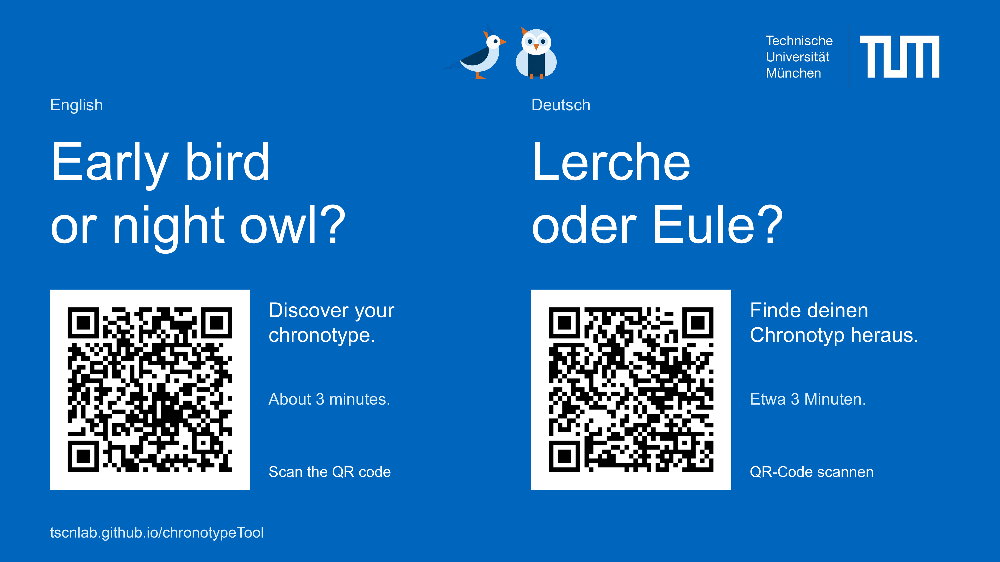

[Open the questionnaire / Zum Fragebogen](index.html)

[Download the 16:9 slide (PDF)](assets/chronotype-invitation.pdf) · [Download the image (PNG, 3840 × 2160)](assets/chronotype-invitation.png)

```{=html}
<figure>
  
  <figcaption><strong>A</strong> Invitation to discover your chronotype</figcaption>
</figure>
```

The QR codes open the published tool directly in [German](https://tscnlab.github.io/chronotypeTool/?lang=de) and [English](https://tscnlab.github.io/chronotypeTool/?lang=en). The tool calculates results on the participant's phone without saving their answers.

## Reproduce the exports

`scripts/slide.mjs` defines the 1600 × 900 slide, its text and original TUM logo placement. `scripts/qr.py` creates both QR codes locally with error correction level Q and a four-module quiet zone. The exported PDF contains one page in 16:9 format. The PNG is rendered from that PDF at 3840 × 2160 pixels.

The English and German headlines use the same font, size and layout. The Bauhaus-style bird illustration is retained in `assets/lark-and-owl.png`, with transparency preserved. It was created with the built-in image-generation tool. The TUM logo is the original supplied artwork.

<details>
<summary>Illustration prompt</summary>

Use case: stylized-concept. Asset type: a small decorative illustration for a TUM university chronotype invitation slide. Create exactly two birds as a Bauhaus geometric composition, a crested lark in profile on the left and a front-facing owl on the right. Their forms must be constructed from a very small number of bold, perfectly flat circles, semicircles, triangles and rectangles, like a 1920s Bauhaus poster or geometric woodcut. Strong abstraction, confident asymmetry and a restrained editorial feel. Lark: semicircle body, circular head, triangular crest, wing and beak. Owl: round head, two simple circular eyes, semicircle wings and compact rectangular body. No realistic feather detail, no ornamental marks, no outlines, no gradients, no texture, no shadows, no glossy cartoon eyes. Palette only white, pale blue #D8ECFA, deep navy #003359, TUM blue #0065BD and orange #E37222. Outer forms mostly white or pale blue so they stand out when placed on a solid TUM-blue slide. Truly transparent background. Wide 2:1 composition, both birds complete, similar visual weight, modest gap between them, minimal outer padding. Crisp print-like edges, legible at a small size. No words, letters, numbers, logos, sun, moon, border or watermark.

</details>

For re-authoring, install `@oai/artifact-tool` 2.8.91 in the authoring environment, Python with `reportlab` and `pypdf`, LibreOffice and Poppler. Make `soffice` and `pdftoppm` available on `PATH`. `ARTIFACT_TOOL_MODULE` can name the absolute module entry point when using a bundled runtime; `SLIDE_PYTHON` can select its Python executable. Arial must be installed; `SLIDE_FONT_DIR` can point to its directory. On macOS, the script uses the system supplemental fonts directory.

The ordinary website build checks and publishes the reviewed exports. Set `REBUILD_EVENT_SLIDE=1` to regenerate them when executing this notebook, or run `npm run slide` before building the website. This keeps the website deployment independent of presentation software.

```{r}
#| label: invitation-exports
if (identical(Sys.getenv("REBUILD_EVENT_SLIDE"), "1")) {
  status <- system2("node", "scripts/slide.mjs")
  stopifnot(status == 0)
}
exports <- c("assets/chronotype-invitation.pdf", "assets/chronotype-invitation.png")
stopifnot(all(file.exists(exports)), all(file.info(exports)$size > 0))
knitr::kable(data.frame(
  Format = c("PDF", "PNG"),
  Dimensions = c("16:9, one page", "3840 × 2160 pixels"),
  MD5 = unname(tools::md5sum(exports))
))
```
